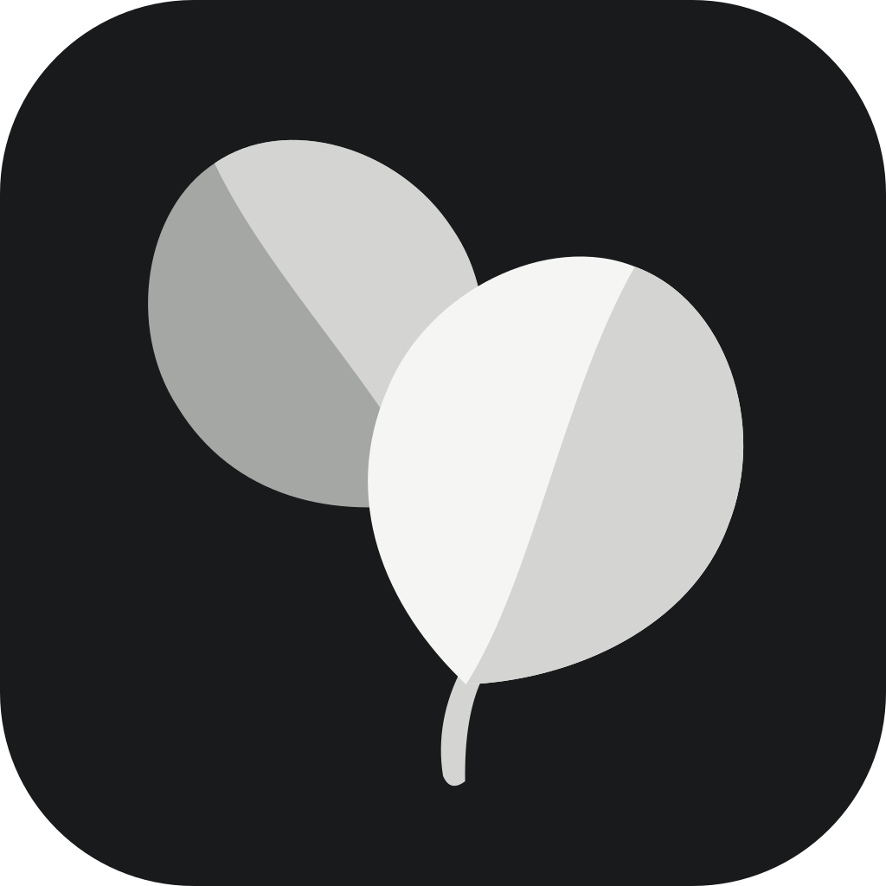

#  Lunaria

### Your loved images, always with you.

A reference image, a place you want to visit, a little reminder of what you're working toward. Put it on your desktop instead of leaving it in a folder.

Lunaria is a small native Windows vision board. Drop in images, arrange them above your wallpaper, and get back to work. Your desktop icons still work. Float the board above another app to keep references beside your work.

Press **Ctrl+Alt+L** to arrange your images. Press it again to let clicks pass through. Your board saves automatically and comes back when you next open Lunaria.

## Get started

**Windows x64 · Portable · No additional application runtime required**

Download [Lunaria 0.1.0](https://github.com/nekoium/Lunaria/releases/tag/0.1.0), extract the ZIP, and run `Lunaria/Lunaria.exe`. Quit any older instance through its notification-area menu before replacing it. The executable is unsigned.

Lunaria stays in the notification area. If Windows hides its icon, look under the overflow arrow. Click the icon to toggle editing, or right-click for image import, board placement, and Quit.

### Install with Scoop

With [Scoop](https://scoop.sh) installed:

```powershell
scoop bucket add lunaria https://github.com/nekoium/Lunaria
scoop install lunaria/lunaria
```

This uses the project's own Scoop bucket. It adds a Start menu shortcut and a `lunaria` command. Quit Lunaria before updating with `scoop update lunaria`. Updating or uninstalling leaves your saved board in `%LOCALAPPDATA%\Lunaria`.

### Build from source

Install Go 1.26.4 or later, then run from this folder on Windows:

```powershell
go build -trimpath -ldflags "-H windowsgui -s -w" -o Lunaria.exe .
.\Lunaria.exe
```

## Make it your board

Press **Ctrl+Alt+L** to enter edit mode. Drop image files onto the board, press **Ctrl+V** to paste copied files or clipboard images, or choose **Add Image…** from the tray menu.

Click an image to select it and bring it to the front. Drag its body to move it, a corner to resize it, or the handle above it to rotate it. Rotation snaps near quarter turns. Press **Delete** to remove the selected image.

PNG, JPEG, GIF, WebP, AVIF, HEIC, HEIF, BMP, and TIFF are supported. Animated or multipage images show their first frame or page; HEIC uses the primary image or first sequence frame. Lunaria reads the file contents, so an AVIF downloaded with a `.jpg` name still opens. No Windows image codec installation is needed.

In edit mode, right-click an image and choose **Download** to get the original back. Lunaria saves the unchanged file in your Downloads folder without replacing existing files.

### Keep references above your work

Press **Ctrl+Alt+Shift+L**, or choose **Float above apps** from the tray menu. The same shortcut or **Return to desktop** puts the board back behind your applications. Placement and editing are independent: you can float images without taking focus away from your current app.

Outside edit mode, clicks pass through images to the desktop or application underneath. In desktop placement, images sit below desktop icons and ordinary application windows. Floating uses Windows' standard always-on-top behavior; exclusive fullscreen apps, secure desktops, and other topmost windows may still cover it.

### Controls

| Action | Control |
| --- | --- |
| Start or finish editing | **Ctrl+Alt+L**, or click the tray icon |
| Switch desktop / floating placement | **Ctrl+Alt+Shift+L**, or the tray menu |
| Add images | Drop files in edit mode, or tray menu **Add Image…** |
| Paste images | **Ctrl+V** in edit mode |
| Select and bring an image to the front | Left-click the image |
| Move / resize / rotate | Drag the body / a corner / the handle above the image |
| Remove the selected image | **Delete** |
| Save an original to Downloads | Right-click an image in edit mode, then **Download** |
| Finish editing | **Escape**, **Ctrl+Tab**, or **Ctrl+Alt+L** |
| Quit | Right-click the tray icon, then **Quit** |

In desktop placement, activating a maximized app also ends editing. Non-maximized apps leave it open. Floating edit mode stays open when you switch apps. Returning to desktop behind a maximized app ends editing. Leaving floating edit mode returns focus to the previous app if it is still open and Lunaria still has focus. During an active file drag, the editor waits until the drop completes before taking keyboard focus. Lunaria starts in desktop normal mode.

## Your board stays yours

Images stay local. Lunaria does not upload them or connect to a service.

Your board lives in `%LOCALAPPDATA%\Lunaria\board.json`, with managed copies in the adjacent `images` folder. Moving or deleting the original files does not break it. Order, positions, sizes, and rotations save after imports, deletions, and completed edits, then restore on launch.

Keep the JSON and image folder together when backing up your board. Copies use additional disk space; deleting an image from the board removes its copy after a successful save. Removing the portable app does not remove your board.

Saves replace the JSON atomically. If a save fails, Lunaria reports the error and keeps the current session in memory; the previous saved board remains intact. An unreadable board or missing or damaged stored image prevents startup rather than silently replacing saved data.

## Current limits

Lunaria currently supports the primary monitor only. There are no settings, automatic startup, or configurable shortcuts. Both global shortcuts must be available; Lunaria reports registration conflicts. Images larger than 40 megapixels are rejected.

Lunaria keeps smaller display copies in memory, capped to a 1080p screen budget. Enlarging an image can make it softer; **Download** preserves the original. Images load one at a time in the background so you can keep editing. Large AVIF files can still take several seconds, with a loading hint and a notification for slow imports. Temporary memory use can rise during decoding.

HEIC/HEIF import uses a bundled decoder and applies container rotation. HEIF files using other codecs may be unsupported. Colors remain in the source color space; ICC profiles and HDR are not converted for display.

On newer Windows desktop layouts, partially transparent image areas can appear darker in desktop normal mode, and exact `#010203` pixels are treated as transparent. Floating placement and edit mode preserve per-pixel transparency. Desktop attachment depends on Explorer; if no suitable desktop host is available, the board stays hidden rather than moving above icons.

## Feedback

[Report a problem or suggest an improvement](https://github.com/nekoium/Lunaria/issues). Check screenshots and board files for private information before sharing them.

## License

Lunaria is available under the [MIT License](LICENSE). Bundled decoder and dependency licenses are included in [third-party notices](THIRD_PARTY_NOTICES.txt).
